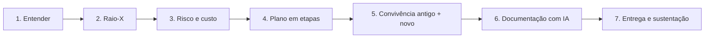

# TARIQ

**Evolua sem parar a operação.**

*TARIQ quer dizer caminho.*

[tariqtech.com.br](https://tariqtech.com.br) · [LinkedIn](https://www.linkedin.com/company/tariqtech) · contato@tariqtech.com.br

---

## O que fazemos

A TARIQ ajuda empresas a modernizar sistemas que viraram freio: planilhas que ninguém entende, automações frágeis, ferramentas no-code e low-code que já não aguentam o volume, conhecimento concentrado em poucas pessoas.

- **Modernização de sistemas**, respeitando o que já funciona
- **Migração em etapas**, sem parar a operação
- **Integração e automação** entre sistemas

## Como trabalhamos

| Etapa | O que acontece |
|---|---|
| 1. Entender | Conversamos sobre a operação, não só sobre a tecnologia. |
| 2. Raio-X | Mapeamos sistemas, automações, integrações e regras de negócio. |
| 3. Risco e custo | Medimos o que custa manter como está e o que pode quebrar. |
| 4. Plano em etapas | Desenhamos a evolução em partes pequenas, cada uma com valor próprio. |
| 5. Convivência | O sistema antigo e o novo rodam juntos até a virada ser segura. |
| 6. Documentação com IA | Usamos IA para documentar o que ninguém documentou. |
| 7. Entrega e sustentação | Treinamento, acompanhamento e melhoria contínua. |

> Os vídeos da série **"Como a TARIQ trabalha"** estão no nosso canal do YouTube (em breve).

## Repositórios abertos

Materiais gratuitos, genéricos e didáticos. Nada aqui contém código ou dados de clientes.

| Repositório | Para quê |
|---|---|
| [`metodo-tariq`](https://github.com/tariqtech-br/metodo-tariq) | O método em 7 etapas, checklist e modelo de inventário de automações |
| [`case-planilhas-para-sistema`](https://github.com/tariqtech-br/case-planilhas-para-sistema) | Case demonstrativo: de planilhas a sistema próprio |
| [`case-bubble-para-sistema-proprio`](https://github.com/tariqtech-br/case-bubble-para-sistema-proprio) | Case demonstrativo: quando o no-code vira gargalo |
| [`case-automacoes-para-integracao`](https://github.com/tariqtech-br/case-automacoes-para-integracao) | Case demonstrativo: de automações frágeis a integração confiável |
| [`guia-lei-do-bem-ti`](https://github.com/tariqtech-br/guia-lei-do-bem-ti) | Guia introdutório da Lei do Bem para projetos de tecnologia |

> Os cases são **demonstrativos, com empresas fictícias**, para mostrar como trabalhamos.

---

Conteúdo mantido com apoio da **Tari**, assistente de inteligência artificial da TARIQ. · TARIQ Tech Desenvolvimento de Software Ltda · Porto Alegre, RS
